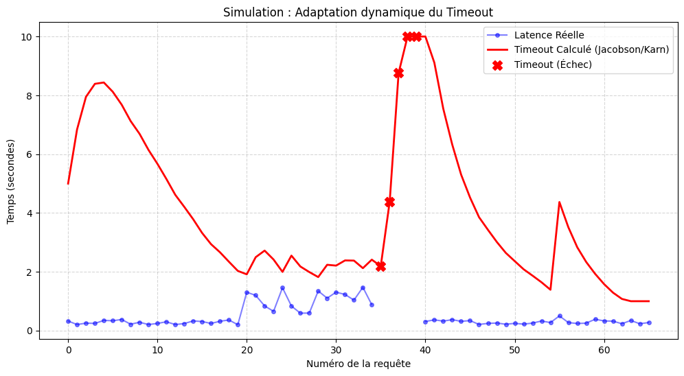

# 🌦️ GeoMeteo

[](https://github.com/alexandrehbty/weather-dashboard/actions/workflows/ci.yaml)


Application web météo sous Flask conçue autour de la résilience réseau : calcul dynamique des timeouts HTTP (algorithme de Jacobson/Karn), cache en mémoire borné et limitation de débit, optimisée pour un hébergement contraint (Render Free Tier, 512 Mo de RAM).

Démo en ligne : https://weather-dashboard-c7gh.onrender.com/

---

## Objectifs techniques

L'application répond à un problème concret : maintenir un backend stable et une interface réactive lorsque l'infrastructure (environnement gratuit, démarrages à froid) et les API tierces présentent une latence variable.

- **Timeouts adaptatifs (`algo.py`)** : remplacement des timeouts statiques par un calcul dynamique basé sur la latence observée.
- **Concurrence maîtrisée** : état partagé protégé par verrou (`threading.Lock`) pour une exécution multi-threadée sous Gunicorn sans dépendance externe (pas de Redis).
- **Interface sobre et résiliente** : autocomplétion avec debounce, carte interactive Leaflet, annulation des requêtes concurrentes (`AbortController`) et accessibilité WCAG.
- **Portabilité Cloud** : configurations Terraform multi-cloud pour 8 fournisseurs, validées statiquement en CI.

---

## Algorithme adaptatif (`algo.py`)

La classe `PortfolioBrain` adapte les principes de la **RFC 6298** (TCP) au calcul du timeout de lecture HTTP (borné entre `1.0 s` et `10.0 s`) :

- **SRTT (Smoothed Round Trip Time)** : moyenne glissante exponentielle de la latence (`alpha = 0.125`).
- **RTTVAR (Round Trip Time Variation)** : estimation de la gigue réseau (`beta = 0.25`, `K = 4`).
- **Règle de Karn** : en cas d'échec ou de timeout, la mesure est ignorée et le timeout est doublé jusqu'au plafond (`10.0 s`).
- **Soft Decay (Cold Start)** : après 10 minutes d'inactivité (`MEMORY_TTL = 600 s`), la variance `RTTVAR` est élargie au réveil afin d'absorber un pic de latence sans effacer l'historique `SRTT`.
- **Horloge monotone et thread-safety** : utilisation de `time.monotonic` (injectable pour les tests et simulations) et protection des lectures/écritures par `threading.Lock`.

### Simulation hors-ligne

Le script `simulation/run_sim.py` rejoue un scénario en 6 phases via une horloge virtuelle et génère le graphique suivant :



| Phase | Requêtes | Comportement observé |
| :--- | :--- | :--- |
| Calme | 0–19 | Convergence progressive du timeout de 5 s vers ~2 s |
| Jitter | 20–34 | Augmentation modérée du timeout pour absorber la variance |
| Panne | 35–39 | Backoff exponentiel jusqu'au plafond de 10 s (règle de Karn) |
| Retour à la normale | 40–54 | Décroissance progressive vers le régime nominal |
| Cold Start (12 min d'inactivité) | 55 | Pic de sécurité (Soft Decay) au réveil |
| Stabilisation | 56–65 | Retour rapide vers la borne basse |

Pour régénérer le graphique :

```bash
python simulation/run_sim.py
```

---

## Architecture et stack technique

### Backend (`app.py`, `algo.py`)

- **Framework** : Python 3.10+, Flask 3, Gunicorn (`--workers 1 --threads 4`).
- **Client HTTP résilient** : `requests.Session` avec `HTTPAdapter` (retries automatiques avec backoff exponentiel sur erreurs transitoires).
- **Cache en mémoire** : cache LRU borné avec TTL configurable (`CACHE_TTL_S=120` par défaut) pour limiter les appels OpenWeather et maîtriser l'empreinte mémoire.
- **Sécurité et observabilité** :
  - Limitation de débit en mémoire via `Flask-Limiter`.
  - En-têtes HTTP de sécurité (HSTS, `X-Frame-Options`, CSP) et identifiant de corrélation.
  - Endpoints de supervision : `/health` (sonde de santé) et `/algo/stats` (métriques `srtt`, `rttvar`, `timeout`, `idle_sec`).

### Frontend (`templates/index.html`, `static/script.js`, `static/style.css`)

- **Vanilla JS** : construction DOM sécurisée (sans `innerHTML` sur les données métier), gestion des timeouts/retries côté client, annulation des requêtes obsolètes (`AbortController`) et cache `Map` avec TTL (2 min).
- **Autocomplétion** : interrogation asynchrone de `/autocomplete` avec debounce (`300 ms`) et priorité aux coordonnées GPS lors de la sélection d'une suggestion.
- **Cartographie** : intégration Leaflet.js avec clic interactif sur la carte (throttling `800 ms`) pour interroger la météo par coordonnées.
- **Responsive et accessibilité** : mise en page adaptée aux smartphones (320 px à 480 px+), tablettes et desktop, lien d'évitement, navigation clavier et attributs ARIA (`aria-live`, `aria-busy`).

---

## Installation et démarrage local

Prérequis : **Python 3.10+**

1. **Cloner le dépôt**

   ```bash
   git clone https://github.com/alexandrehbty/weather-dashboard.git
   cd weather-dashboard
   ```

2. **Créer et activer l'environnement virtuel**

   ```bash
   # Linux / macOS
   python3 -m venv venv
   source venv/bin/activate

   # Windows (PowerShell)
   python -m venv venv
   .\venv\Scripts\Activate.ps1
   ```

3. **Installer les dépendances**

   ```bash
   pip install -r requirements.txt
   ```

4. **Configurer les variables d'environnement**

   Créer un fichier `.env` à la racine du projet :

   ```ini
   # Clé API OpenWeather : https://home.openweathermap.org/api_keys
   API_KEY=votre_cle_api_openweather
   FLASK_DEBUG=1
   CACHE_TTL_S=120
   ```

5. **Lancer le serveur local**

   ```bash
   python app.py
   ```

   L'application est accessible sur `http://127.0.0.1:5000`.

---

## Tests et intégration continue

Le pipeline GitHub Actions (`.github/workflows/ci.yaml`) exécute automatiquement à chaque push :

1. **Tests unitaires (`tests/test_unitaire.py`)** : 29 tests couvrant `PortfolioBrain` (Jacobson, Karn, Soft Decay, thread-safety), le cache LRU/TTL et les routes Flask (validation des paramètres, mapping des codes HTTP, en-têtes de sécurité).
2. **Tests E2E (`e2e/test_e2e.py`)** : suite Playwright avec Page Object Model (`e2e/pages/weather_page.py`) couvrant le parcours nominal, les cas d'erreur, la résilience réseau, la sécurité (XSS, CSP), l'accessibilité WCAG 2.1 (`axe-playwright-python`), le cache frontend, le rate limiting et `/algo/stats`.
3. **Validation statique Terraform** : matrice sur les 8 fournisseurs Cloud (`terraform fmt -check`, `terraform init -backend=false`, `terraform validate`).
4. **Build Docker** : construction et publication de l'image sur GHCR (`ghcr.io`).

### Exécution locale

```bash
# Tests unitaires
python -m pytest tests/test_unitaire.py -v

# Tests unitaires avec rapport de couverture
python -m pytest tests/test_unitaire.py --cov=algo --cov=app --cov-report=term-missing

# Tests E2E (nécessite le serveur Flask démarré sur le port 5000)
python -m pytest e2e/test_e2e.py --base-url=http://127.0.0.1:5000 --reruns 2 -v
```

---

## Déploiement et Infrastructure as Code

### Déploiement Render (démo publique)

La démo est déployée avec Gunicorn en mode mono-worker / multi-thread afin de rester sous la limite de 512 Mo de RAM :

```bash
gunicorn app:app --workers 1 --threads 4 --timeout 60
```

### Configurations Terraform multi-cloud (`terraform/`)

Le dossier `terraform/` regroupe 8 implémentations couvrant trois paradigmes d'hébergement :

- **Serverless / CaaS** : AWS (`App Runner`), Azure (`Container Apps`), GCP (`Cloud Run v2`), Scaleway (`Serverless Containers`).
- **IaaS avec cloud-init** : Hetzner Cloud (instances CX), OVHcloud (OpenStack).
- **Conteneurs managés avec réseau dédié (VPC/VCN)** : Alibaba Cloud (ECI), Oracle Cloud Infrastructure (Container Instances).

Ces configurations sont validées statiquement en local et en CI (`fmt`, `init -backend=false`, `validate`) sans déploiement cloud actif afin d'éviter tout coût d'infrastructure. Les fichiers d'état (`.tfstate`), de variables locales (`*.tfvars`) et de verrouillage (`.terraform.lock.hcl`) sont exclus par `.gitignore`.

Pour le détail des prérequis, variables (`terraform.tfvars.example`) et commandes de validation, consulter [terraform/README.md](terraform/README.md).

---

## Intégrité et signature des commits

Les commits de ce dépôt sont signés cryptographiquement avec **GnuPG (Kleopatra / OpenPGP)** afin de garantir l'authenticité de leur auteur (badge `Verified` sur GitHub).

La clé publique associée est disponible dans le dépôt (`public_key.asc`). Pour l'importer et vérifier les signatures en local :

```bash
gpg --import public_key.asc
git log --show-signature -n 5
```

---

## Structure du projet

```text
.
├── .github/
│   └── workflows/
│       └── ci.yaml                     # Pipeline CI (tests unitaires, E2E, Terraform, Docker)
├── e2e/
│   ├── __init__.py
│   ├── conftest.py                     # Fixtures Playwright et nettoyage des mocks réseau
│   ├── test_e2e.py                     # Suite de tests E2E (UX, sécurité, WCAG, résilience)
│   └── pages/
│       ├── __init__.py
│       └── weather_page.py             # Page Object Model (POM)
├── simulation/
│   ├── resultat_graphique.png          # Graphique de simulation Jacobson/Karn
│   └── run_sim.py                      # Script de simulation à horloge virtuelle
├── static/
│   ├── script.js                       # Client JS (AbortController, cache TTL, Leaflet)
│   └── style.css                       # Feuille de style responsive (mobile-friendly)
├── templates/
│   └── index.html                      # Template Jinja2 (CSP, sémantique et A11Y)
├── terraform/
│   ├── alibaba/                        # Alibaba Cloud (ECI, VPC/VSwitch)
│   ├── aws/                            # AWS (App Runner, Secrets Manager)
│   ├── azure/                          # Azure (Container Apps, Log Analytics)
│   ├── gcp/                            # GCP (Cloud Run v2, Secret Manager)
│   ├── hetzner/                        # Hetzner Cloud (VM + cloud-init)
│   ├── oracle/                         # OCI (Container Instances, VCN)
│   ├── ovh/                            # OVHcloud (OpenStack + cloud-init)
│   ├── scaleway/                       # Scaleway (Serverless Containers)
│   ├── README.md                       # Documentation d'architecture et validation IaC
│   └── terraform.tfvars.example        # Modèle de variables Terraform
├── tests/
│   └── test_unitaire.py                # Tests unitaires (algo.py, cache LRU, app.py)
├── algo.py                             # Algorithme Jacobson/Karn (RFC 6298) thread-safe
├── app.py                              # Application Flask (API météo, cache, rate limiting)
├── Dockerfile                          # Image conteneur de l'application
├── Procfile                            # Commande de démarrage Gunicorn (Render)
├── README.md                           # Documentation principale
├── requirements.txt                    # Dépendances Python
├── .gitignore                          # Exclusions Git (secrets, .env, états Terraform, venv)
├── public_key.asc                      # Clé publique OpenPGP (vérification des commits signés)
└── LICENCE                             # Licence MIT
```